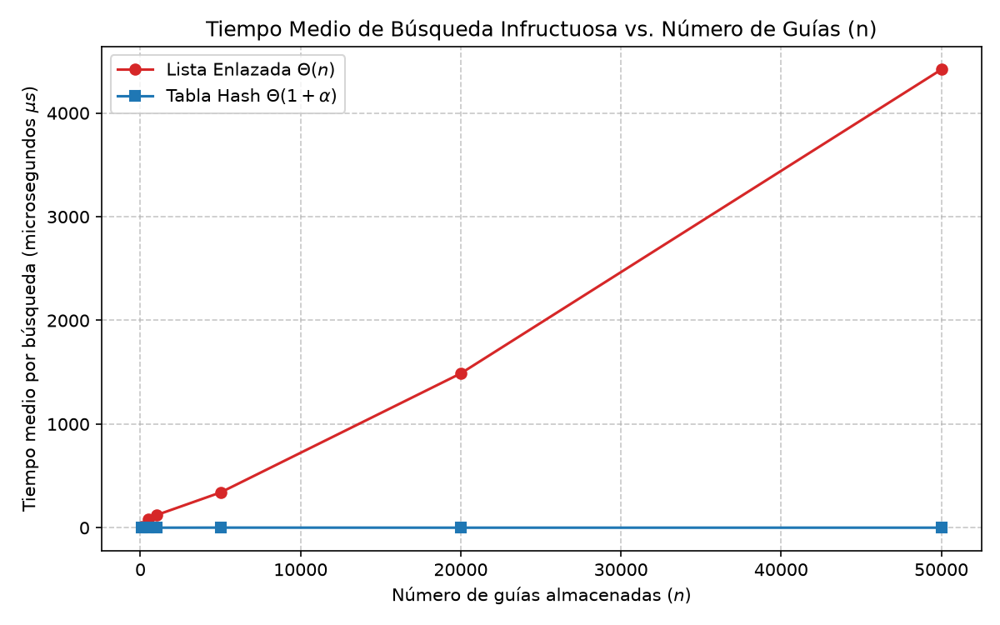
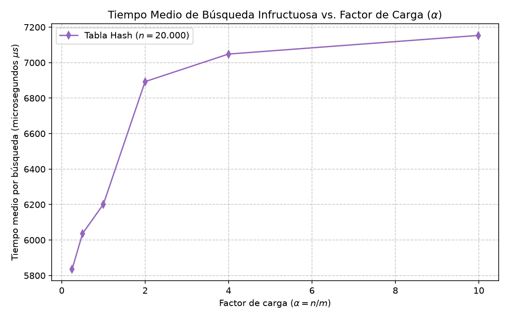

# Laboratorio 3 — Estructuras de Datos: Rediseño del Sistema de Consultas de Envíos 
**Estudiante:** Mariana García Hincapié 
**Curso:** Análisis y Diseño de Algoritmos 
--- 
## Instrucciones de Reproducción 
Para ejecutar la suite de pruebas de verificación, reproducir los experimentos de medición de tiempo de búsqueda y regenerar las gráficas, ejecute los siguientes comandos desde la terminal: 

1. **Ubicarse en el directorio del laboratorio:** 
    ```bash 
    cd laboratorios/lab3-estructuras-datos

2. **Activar el entorno virtual del repositorio:**
    * En Linux / macOS:
    source ../../env/bin/activate


    * En Windows (PowerShell):
    ..\..\env\Scripts\Activate.ps1


3. **Ejecutar las pruebas de verificación unitarias (Parte 1):**

```
    python pruebas.py

```

4. **Ejecutar las mediciones experimentales y regenerar las gráficas (Parte 2):**

```
python medicion.py
```

## Parte 1 — Implementación y Verificación

&gt; **Enlaces a los archivos de código de esta sección:**

* Implementación de las estructuras de datos: [estructuras.py](estructuras.py)
* Suite de pruebas de verificación unitaria: [pruebas.py](pruebas.py)

### Descripción del proceso de verificación

Para garantizar la corrección lógica y la solidez técnica de la **Lista Enlazada** y de la **Tabla Hash con Encadenamiento** antes de realizar las mediciones de tiempo, se diseñó un conjunto de pruebas automáticas en [pruebas.py](pruebas.py) utilizando aserciones (`assert`). La verificación cubrió cuatro escenarios fundamentales:

**1. Búsqueda exitosa e infructuosa:** Se verificó que ambas estructuras retornaran la cadena exacta del estado para guías existentes (`"en bodega"`, `"en reparto"`) y retornaran estrictamente `None` para guías inexistentes.

**2. Colisión forzada explícita ($m = 7$):** Se insertaron las guías $10$, $24$ y $17$. Dado que $10 \pmod 7 = 3$, $24 \pmod 7 = 3$ y $17 \pmod 7 = 3$, las tres guías colisionaron en la casilla $3$. Se confirmó que la lista de la casilla $3$ almacenó $3$ nodos, que las tres guías fueron encontradas individualmente y que factor_carga() calculó exactamente $3/7$.

**3. Prueba aleatoria masiva (25 iteraciones):** Se generaron 25 colecciones aleatorias con un tamaño $n$ variable entre $10$ y $100$. Se confirmó coincidencia exacta del $100%$ en las respuestas de búsqueda entre la lista enlazada y la tabla hash, evaluando tanto claves existentes como búsquedas infructuosas.


## Parte 2 — Medición Experimental y Gráficas

&gt; **Enlaces a los archivos de código de esta sección:**

* Script de medición de tiempos y generación de gráficas: [medicion.py](medicion.py)

### Metodología de medición

Las mediciones se registraron utilizando la función de alta precisión `time.perf_counter()`. Para simular el escenario de mayor impacto en el call center (búsquedas de guías inexistentes mal digitadas), cada valor registrado representa el **tiempo promedio de 200 búsquedas infructuosas** de guías aleatorias de 10 dígitos generadas con la función `generar_guias_inexistentes()`, garantizando que ninguna estuviera presente en la colección.

**Tabla de datos medidos — Experimento A (Lista frente a Tabla Hash)**
Para cada tamaño $n$, la tabla utilizó un número primo $m \approx n / 2$, manteniendo un factor de carga cercano a $\alpha \approx 2$:

| Guías almacenadas ($n$) | Casillas ($m$) | Factor de Carga Real ($\\alpha$) | Tiempo Lista ($\\mu s$) | Tiempo Tabla ($\\mu s$) | | :---: | :---: | :---: | :---: | :---: | | $100$ | $53$ | $1,89$ | $12,06$ | $0,58$ | | $500$ | $251$ | $1,99$ | $81,89$ | $0,30$ | | $1.000$ | $503$ | $1,99$ | $122,04$ | $0,60$ | | $5.000$ | $2.503$ | $2,00$ | $340,08$ | $1,26$ | | $20.000$ | $10.007$ | $2,00$ | $1.488,38$ | $0,53$ | | $50.000$ | $25.013$ | $2,00$ | $4.419,42$ | $0,68$ |

**Tabla de datos medidos — Experimento B (Efecto de $\alpha$ con $n = 20.000$ fijo)**

| Factor Carga Objetivo ($\\alpha$) | Casillas ($m$) | Factor Carga Real ($\\alpha$) | Tiempo Medio Tabla ($\\mu s$) | | :---: | :---: | :---: | :---: | | $0,25$ | $80.021$ | $0,25$ | $5.836,17$ | | $0,50$ | $40.009$ | $0,50$ | $6.036,56$ | | $1,00$ | $20.011$ | $1,00$ | $6.201,95$ | | $2,00$ | $10.007$ | $2,00$ | $6.893,00$ | | $4,00$ | $5.003$ | $4,00$ | $7.048,39$ | | $10,00$ | $2.003$ | $9,99$ | $7.153,42$ |

### Gráficas de comportamiento empírico 
#### Gráfica 1: Tiempo Medio de Búsqueda Infructuosa frente a $n$ 
 
#### Gráfica 2: Tiempo Medio de Búsqueda Infructuosa frente a $\alpha$ 



## Parte 3 — Análisis e Interpretación

### 1. Costo teórico y supuesto de Hash Uniforme
En una Lista Enlazada, cuando se realiza una búsqueda de una guía que no existe, el algoritmo no tiene forma de saber de antemano si la clave estará al final. Por lo tanto, está obligado a recorrer secuencialmente cada uno de los $n$ nodos de la lista hasta llegar a `None`. Esto impone un costo determinista lineal de $\Theta(n)$ comparaciones.

**En la Tabla Hash con Encadenamiento**, la búsqueda calcula primero la función hash $h(k) = k \bmod m$ en tiempo constante $\Theta(1)$ para determinar la casilla, y luego recorre únicamente la lista enlazada alojada en esa casilla. Bajo la suposición de Hash Uniforme Simple (donde cualquier clave tiene la misma probabilidad de ser asignada a cualquiera de las $m$ casillas de forma independiente), la longitud esperada de la lista en una casilla es el factor de carga $\alpha = n / m$. Por ende, la búsqueda de un elemento inexistente examina en promedio $\alpha$ nodos, resultando en un costo computacional de $\Theta(1 + \alpha)$.

**¿Qué ocurriría si todas las guías cayeran en la misma casilla ($m = 1$)?**
Si la función hash falla completamente o si la tabla se configura con una sola casilla ($m = 1$), todos los $n$ elementos colisionan en la misma lista enlazada. En este escenario de degeneración total, el tiempo promedio de búsqueda pasa de $\Theta(1 + \alpha)$ a $\Theta(n)$, perdiendo por completo la ventaja algorítmica de la tabla hash.

### 2. Lo medido contra lo esperado
Al analizar los datos experimentales de la primera gráfica (graficas/lista_vs_tabla.png), tomamos dos valores de $n$ donde el volumen crece por un factor de $2,5\times$ (de $n_1 = 20.000$ a $n_2 = 50.000$):

* **Lista Enlazada:** El tiempo medio de búsqueda pasó de $1.488,38\ \mu s$ a $4.419,42\ \mu s$, multiplicándose por un factor de $2,97\times$. Este crecimiento escala de forma directamente proporcional al tamaño de la entrada, respaldando la complejidad lineal $\Theta(n)$.

* **Tabla Hash:** Para el mismo incremento de $2,5\times$ en los datos, el tiempo pasó de $0,53\ \mu s$ a $0,68\ \mu s$ (multiplicándose por solo $1,28\times$). Al mantener el factor de carga constante en $\alpha \approx 2$, el tiempo permaneció en la escala de fracciones de microsegundo sin verse afectado por la magnitud de $n$, lo que coincide con la predicción de tiempo constante $\Theta(1)$.

En la segunda gráfica (`graficas/tiempo_vs_alfa.png`), manteniendo $n = 20.000$ fijo, cuando $\alpha$ pasa de $0,25$ a $9,99$:

* El tiempo pasa de $5.836,17\ \mu s$ a $7.153,42\ \mu s$.
* La curva exhibe una tendencia ascendente continua a medida que la tabla se vuelve más densa. Esto valida la fórmula $\Theta(1 + \alpha)$: al aumentar el número de elementos por casilla, el algoritmo debe examinar listas enlazadas más largas, incrementando linealmente el tiempo de búsqueda.


### 3. Explicación de colisiones y mecanismos de resolución
Una colisión se produce cuando dos guías distintas $k_1 \neq k_2$ generan el mismo valor de índice al ser procesadas por la función hash, es decir, $h(k_1) = h(k_2)$. Las colisiones son inevitables debido al Principio del Palomar: el espacio de claves posibles (guías de 10 dígitos) tiene un tamaño de $10^{10}$ combinaciones, mientras que el espacio de casillas de la tabla $m$ es significativamente menor.

#### Comparación de mecanismos de resolución de colisiones:
**1. Encadenamiento (Chaining):** Cada casilla de la tabla contiene una lista enlazada independiente que almacena todas las claves que colisionan en ese índice.
    * *Ventaja:* Maneja de forma transparente factores de carga $\alpha > 1$. La inserción no requiere reestructurar la tabla.
    * *Costo:* Requiere memoria adicional para almacenar los punteros `siguiente` en cada nodo.

**2. Direccionamiento Abierto (Open Addressing):** Todos los elementos se guardan directamente dentro de las casillas de la tabla. Ante una colisión, se utiliza una secuencia de sondeo para encontrar la siguiente casilla desocupada.
 * *Ventaja:* No consume memoria en punteros y aprovecha la velocidad de la memoria caché.
 * *Costo:* Exige mantener $\alpha < 1$. Si la tabla se llena, los tiempos de búsqueda aumentan exponencialmente.

### Ejemplo con $m = 7$ y las guías $10$, $24$ y $17$:
Calculando $h(k) = k \bmod 7$:
    * $h(10) = 10 \bmod 7 = 3$
    * $h(24) = 24 \bmod 7 = 3$
    * $h(17) = 17 \bmod 7 = 3$

Con encadenamiento, la casilla $3$ aloja la lista `17 -&gt; 24 -&gt; 10 -&gt; None`. La casilla $3$ tiene una longitud de $3$ nodos y un factor de carga de $\alpha = 3/7$, resolviendo la colisión sin afectar a las demás casillas.

### 4. Tabla Hash frente a Árbol de Búsqueda Binario (BST)

**¿Sirve la tabla hash para monitoreo por rango ("guías entre X y Y")?**
No, la tabla hash no es adecuada para consultas por rango. La función hash asigna las claves en las $m$ casillas de forma pseudoaleatoria para maximizar la dispersión, destruyendo la relación de orden natural de los números. Para responder a una consulta por rango $[X, Y]$, la tabla hash no tiene un camino estructurado y se ve obligada a recorrer todas sus $m$ casillas y examinar los $n$ elementos almacenados, consumiendo un tiempo ineficiente de $O(m + n)$.

**Ventaja del Árbol de Búsqueda Binario (BST)**
Un *BST* mantiene las claves ordenadas mediante su propiedad estructural ($clave_{izq} < clave_{nodo} < clave_{der}$). Para una consulta por rango:
    * Localiza la clave inicial $X$ descendiendo por el árbol en tiempo $O(H)$ (donde $H$ es la altura).* Realiza un recorrido en orden (inorder) visitando únicamente los $k$ nodos que caen dentro del rango $[X, Y]$ en tiempo $O(k)$.
    * El costo total es de $O(H + k)$, infinitamente superior al barrido completo de la tabla hash.

**Degeneración de un BST con $400.000$ guías preordenadas**

Si las $400.000$ guías ingresan preordenadas una a una, el BST no puede balancearse y degenera en una lista enlazada de un solo brazo:
    * Altura resultante ($H$): $H = n - 1 = 399.999$.
    * Búsqueda peor caso: Requeriría $400.000$ comparaciones por consulta.
    * Comparación con un árbol equilibrado (AVL / Red-Black): Un árbol autobalanceado mantiene una altura logarítmica estricta $H = \lceil \log_2(400.000) \rceil = 19$. Cualquier consulta se resolvería en máximo 19 comparaciones, frente a las $400.000$ del árbol degenerado.

### 5. Concepto Técnico para la Jefa de Operaciones

**Para:** Jefatura de Operaciones — Rutas del Caribe 
**De:** Departamento de Desarrollo de Software y Analítica 
**Asunto:** Rediseño arquitectónico para consultas puntuales y monitoreo por rango

**Recomendación Arquitectónica Híbrida**
Para resolver simultáneamente las dos necesidades operativas sin comprometer el rendimiento en hora pico, se recomienda implementar una solución híbrida:
    1. Atención en Call Center (Consulta Puntual): Implementar una Tabla Hash con Encadenamiento dimensionada con $\alpha \approx 0,5$ ($m \approx 2n$). Esto garantiza respuestas inmediatas en tiempo constante $\Theta(1)$ para los operadores.
    2. Supervisión de Rutas (Monitoreo por Rango): Mantener de forma paralela un Árbol Autobalanceado (Red-Black / AVL). Permite extraer lotes de guías ordenadas en rango $[X, Y]$ en tiempo $O(\log n + k)$.

**Estimación de tiempos para $5.000.000$ de envíos ($N = 5.000.000$)**
Extrapolando los tiempos medidos en el Experimento A para $n = 50.000$:
    * Lista Enlazada (Sistema Actual):
    $$T(N) \approx \left(\frac{4.419,42\ \mu s}{50.000}\right) \times 5.000.000 \approx 441.942\ \mu s \approx \mathbf{0,442\text{ segundos por consulta}}.$$
    *Evaluación:* Inviable. En horas pico con miles de llamadas simultáneas, la latencia acumulada provocaría el colapso del sistema.
    * Tabla Hash (Sistema Recomendado con $\alpha \approx 2$):
    $$T(N) \approx \mathbf{0,68\ \mu s\text{ por consulta (0,00000068 segundos)}}.$$
    *Evaluación:* Altamente eficiente. Permite procesar más de $1.400.000$ consultas por segundo de forma transparente.
    *Aclaración:* Estas cifras corresponden a una estimación por extrapolación matemática basada en las tendencias medidas en la máquina de prueba; no constituyen una medición directa sobre un entorno de producción con $5.000.000$ de registros.
